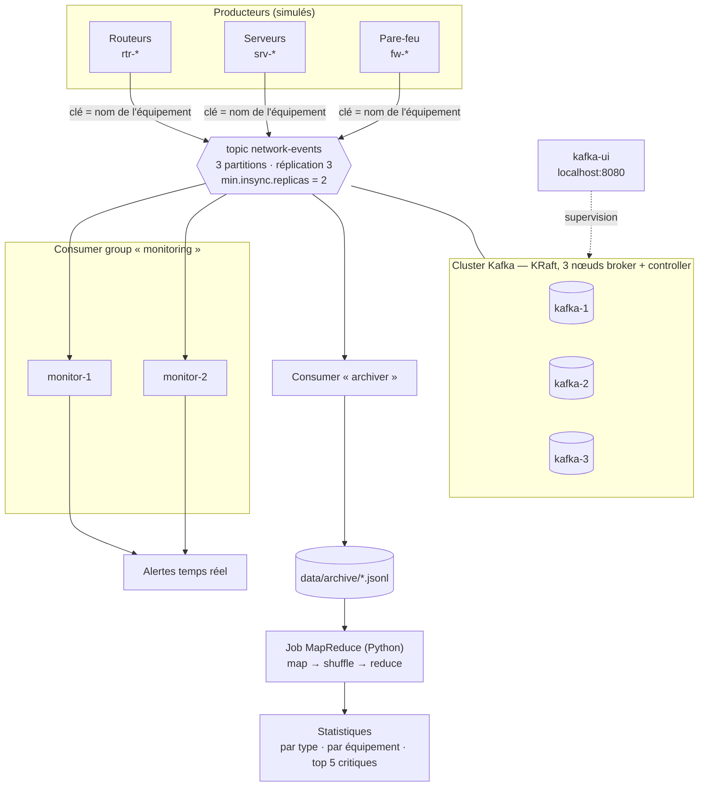

# kafka-streaming-pipeline

> **EN —** A 3-broker Apache Kafka cluster (KRaft mode) streaming simulated network-monitoring events in real time to parallel consumers, with a broker-failure demo and a pure-Python MapReduce job analysing the archived data.
> Built with Docker Compose and Python to demonstrate distributed systems: replication, fault tolerance, stream and batch processing.


Pipeline de données distribué de bout en bout : des équipements réseau simulés (routeurs, serveurs, pare-feu) envoient des événements de supervision dans un **cluster Kafka de 3 brokers**. Ces événements sont traités **en temps réel** par un consumer group qui lève des alertes, et archivés sur disque pour un traitement **par lots (batch)** avec **MapReduce**.

## Sommaire

- [Objectif](#objectif)
- [Architecture](#architecture)
- [Rôle de chaque composant](#rôle-de-chaque-composant)
- [Prérequis](#prérequis)
- [Lancement en 3 commandes](#lancement-en-3-commandes)
- [Démonstration](#démonstration)
- [Structure du projet](#structure-du-projet)
- [Ce que j'ai appris](#ce-que-jai-appris)
- [Améliorations possibles](#améliorations-possibles)

## Objectif

Montrer concrètement le fonctionnement d'un système distribué :

- **un cluster de plusieurs nœuds** : 3 brokers Kafka en mode KRaft, sans ZooKeeper ;
- **la réplication** : chaque partition est copiée sur les 3 brokers (`replication.factor=3`, `min.insync.replicas=2`) ;
- **la tolérance aux pannes** : on arrête un broker en plein flux et aucun message n'est perdu ;
- **le traitement en temps réel** : un consumer group dont les 2 instances se partagent les partitions ;
- **le traitement par lots** : un job MapReduce (map → shuffle → reduce) sur les données archivées.

## Architecture



| Flux | Type de traitement | Garantie |
|---|---|---|
| Producteur → Kafka | Streaming | `acks=all` + idempotence : pas de perte ni de doublon côté producteur |
| Kafka → monitoring | Streaming, temps réel | Partitions réparties entre les 2 instances du groupe |
| Kafka → archiver | Streaming vers fichiers | *At-least-once* : commit de l'offset après écriture sur disque |
| Archives → MapReduce | Batch | Calcul déterministe, résultats identiques en séquentiel et en parallèle |

## Rôle de chaque composant

| Composant | Fichier | Rôle |
|---|---|---|
| Cluster Kafka | [`docker-compose.yml`](docker-compose.yml) | 3 nœuds `apache/kafka:3.9.1`. Chacun est **broker** (stocke les messages) et **controller** (gère les métadonnées via Raft). Le quorum de 3 controllers survit à la perte d'un nœud. |
| Interface web | [`docker-compose.yml`](docker-compose.yml) | `kafbat/kafka-ui:v1.3.0` pour voir les brokers, le topic, les messages et les consumer groups. |
| Création du topic | [`scripts/create-topic.sh`](scripts/create-topic.sh) | Crée `network-events` (3 partitions, réplication 3, `min.insync.replicas=2`) et affiche leaders et ISR. |
| Producteur | [`producer/producer.py`](producer/producer.py) | Génère des événements JSON réalistes (8 types : `link_down`, `high_latency`, `packet_loss`, `cpu_high`, `memory_high`, `disk_full`, `login_failed`, `port_scan`) avec une sévérité calculée par seuils. **Clé = nom de l'équipement**, donc les événements d'un même équipement vont dans la même partition et restent dans l'ordre. |
| Monitoring | [`consumer/monitor.py`](consumer/monitor.py) | Consumer group `monitoring`. Les instances se partagent les partitions, affichent les alertes critiques avec leur partition et leur offset, et journalisent chaque rééquilibrage. |
| Archiveur | [`consumer/archiver.py`](consumer/archiver.py) | Consumer group `archiver`. Écrit chaque événement dans `data/archive/events-AAAAMMJJ-HH.jsonl` et ne commite l'offset qu'après l'écriture sur disque. |
| Test de panne | [`scripts/test-broker-failure.sh`](scripts/test-broker-failure.sh) | Arrête le broker leader pendant que le flux tourne, montre l'élection d'un nouveau leader et le flux qui continue, puis le redémarre. Montre aussi le rééquilibrage du consumer group. |
| MapReduce (streaming) | [`mapreduce/mapper.py`](mapreduce/mapper.py), [`mapreduce/reducer.py`](mapreduce/reducer.py) | Compatibles **Hadoop Streaming** (stdin → stdout, `clé\tvaleur`). |
| MapReduce (parallèle) | [`mapreduce/parallel_job.py`](mapreduce/parallel_job.py) | Exécute split → map → shuffle → reduce sur plusieurs processus (`multiprocessing`), en affichant chaque phase. |
| Commandes | [`Makefile`](Makefile) | `make up`, `make topic`, `make produce`, `make consume`, `make failover`, `make mapreduce`, `make down`. |

## Prérequis

- **Docker Desktop** (Windows avec WSL2, macOS ou Linux), avec au moins 4 Go de RAM alloués
- **Python 3.10+**
- **Git Bash** sous Windows, pour `make` et les scripts `.sh`. GNU Make s'installe par exemple avec `choco install make` ou `scoop install make`.
- Ports libres : `8080` (kafka-ui), `19092`, `29092`, `39092` (brokers)

Installation des dépendances Python (une seule librairie, `confluent-kafka`) :

```bash
make install        # crée .venv et installe requirements.txt
```

## Lancement en 3 commandes

```bash
make up         # démarre les 3 brokers + kafka-ui
make topic      # crée le topic network-events
make produce    # envoie des événements (RATE=5 DEVICES=12 par défaut)
```

Ouvre ensuite **http://localhost:8080** puis *Topics → network-events → Messages* : les événements arrivent en temps réel.

Dans un second terminal :

```bash
make consume    # 2 consommateurs "monitoring" + l'archiveur
```

Toutes les commandes disponibles :

```text
make help
  make install              Crée l'environnement virtuel .venv et installe les dépendances
  make up                   Démarre le cluster Kafka (3 brokers) et kafka-ui
  make topic                Crée le topic network-events (3 partitions, réplication 3)
  make produce              Lance le producteur (options : RATE=5 DEVICES=12)
  make consume              Lance 2 consommateurs "monitoring" + l'archiveur (Ctrl+C pour tout arrêter)
  make monitor              Lance un seul consommateur "monitoring"
  make archive              Lance uniquement l'archiveur
  make failover             Démo de tolérance aux pannes (broker arrêté + rééquilibrage)
  make mapreduce            Job MapReduce parallèle sur data/archive/
  make mapreduce-streaming  MapReduce style Hadoop Streaming : mapper | sort | reducer
  make test                 Lance les tests du MapReduce
  make down                 Arrête le cluster (les messages Kafka sont supprimés, pas data/archive/)
  make clean                Arrête le cluster et supprime les archives locales
```

## Démonstration

### 1. Le cluster et le topic

`make topic` affiche la répartition des partitions. Chaque broker est leader d'une partition, et chaque partition a 3 répliques synchronisées (ISR) :

```text
Partition: 0  Leader: 3  Replicas: 3,1,2  Isr: 3,1,2
Partition: 1  Leader: 1  Replicas: 1,2,3  Isr: 1,2,3
Partition: 2  Leader: 2  Replicas: 2,3,1  Isr: 2,3,1
```


### 2. Traitement en temps réel

Le producteur affiche la partition de chaque message. Un même équipement (même clé) tombe toujours dans la même partition :

```text
  partition=2 offset=257    fw-paris-01      login_failed  critical 29 attempts
  partition=2 offset=258    fw-paris-01      link_down     critical 3 interfaces
  partition=0 offset=319    rtr-paris-01     packet_loss   critical 24.57 %
```

Les 2 consommateurs du groupe `monitoring` se partagent les 3 partitions et affichent les alertes :

```text
[monitor-1] REEQUILIBRAGE -> partitions attribuées : [0, 1]
[monitor-2] REEQUILIBRAGE -> partitions attribuées : [2]
[monitor-1] ALERTE CRITICAL p0/off330    fw-lille-01      port_scan     scan de 1794 ports détecté
[monitor-1] ALERTE CRITICAL p1/off163    rtr-lille-01     packet_loss   perte de paquets 12.75 %
```


### 3. Panne d'un broker

`make failover` arrête le broker leader de la partition 0 pendant que le producteur tourne :

```text
==> Arrêt de kafka-3 (leader de la partition 0)
    Partition: 0 Leader: 1 Replicas: 3,1,2 Isr: 1,2      <- nouveau leader élu, ISR = 2
==> Le flux continue pendant 20s avec un broker en moins
    Offsets de fin : p0=1059  p1=439  p2=1196  | total=2694
    Offsets de fin : p0=1107  p1=446  p2=1221  | total=2774
    Offsets de fin : p0=1148  p1=456  p2=1247  | total=2851
==> Redémarrage de kafka-3
    Partition: 0 Leader: 3 Replicas: 3,1,2 Isr: 1,2,3    <- resynchronisé
==> Fin du producteur
    Bilan : 750 envoyés, 750 confirmés, 0 échecs, 0 sans réponse
    OK : aucun message perdu malgré la panne de kafka-3
```

Avec 2 répliques sur 3 encore dans l'ISR, la condition `min.insync.replicas=2` reste satisfaite : les écritures `acks=all` continuent d'être acceptées.

Le script montre ensuite le **rééquilibrage du consumer group** quand un consommateur s'arrête brutalement :

```text
monitor-2 -> partitions (2)
monitor-1 -> partitions (0,1)
   … arrêt de monitor-2, détecté après session.timeout.ms (10 s) …
monitor-1 -> partitions (0,1,2)
```


### 4. Analyse batch avec MapReduce

```bash
make mapreduce                # version parallèle (multiprocessing)
make mapreduce-streaming      # cat ... | mapper.py | sort | reducer.py
```

```text
=== Phase 0 : SPLIT ===
  -> 3148 lignes découpées en 7 splits de 500 lignes max
=== Phase 1 : MAP (4 processus) ===
  split   0 traité par le processus 8904 : 500 lignes -> 1271 paires
  ...
=== Phase 2 : SHUFFLE (vers 4 reducers) ===
  reducer 0 reçoit  11 clés (2441 valeurs)
  ...
=== Phase 3 : REDUCE (4 reducers) ===

Événements analysés : 3148  (dont 861 critiques)

Événements par type
  cpu_high          808  ██████████████████████████████
  login_failed      517  ███████████████████
  link_down         480  ██████████████████
  ...
Top 5 des équipements les plus critiques
  1. fw-lille-01       104  ██████████████████████████████
  2. rtr-lyon-01       102  █████████████████████████████
  3. fw-lyon-01         96  ████████████████████████████
  4. srv-paris-01       81  ███████████████████████
  5. rtr-lille-01       79  ███████████████████████
```

Les deux versions donnent exactement le même résultat, ce que vérifient les tests (`make test`).


## Structure du projet

```text
kafka-streaming-pipeline/
├── docker-compose.yml          # 3 brokers Kafka KRaft + kafka-ui
├── Makefile                    # commandes du projet
├── requirements.txt            # confluent-kafka
├── producer/
│   └── producer.py             # événements réseau simulés
├── consumer/
│   ├── monitor.py              # consumer group "monitoring" : alertes temps réel
│   └── archiver.py             # consumer "archiver" : data/archive/*.jsonl
├── mapreduce/
│   ├── mapper.py               # phase map (Hadoop Streaming)
│   ├── reducer.py              # phase reduce (Hadoop Streaming)
│   ├── parallel_job.py         # map → shuffle → reduce avec multiprocessing
│   └── test_mapreduce.py       # tests unitaires
├── scripts/
│   ├── create-topic.sh         # création du topic
│   └── test-broker-failure.sh  # démo de tolérance aux pannes
└── docs/
    ├── EXPLICATIONS.md         # concepts + questions d'entretien
    └── images/                 # captures d'écran
```

Les notions utilisées (partition, offset, ISR, consumer group, KRaft, MapReduce…) sont expliquées dans **[docs/EXPLICATIONS.md](docs/EXPLICATIONS.md)**, avec 10 questions d'entretien.

## Ce que j'ai appris

- **Partitionnement et ordre** : Kafka ne garantit l'ordre qu'à l'intérieur d'une partition. Choisir le nom de l'équipement comme clé garantit l'ordre des événements de chaque équipement, tout en répartissant la charge.
- **Réplication et durabilité** : il faut combiner `replication.factor=3`, `min.insync.replicas=2` et `acks=all` pour obtenir une écriture qui survit à la perte d'un broker. Un seul de ces réglages ne suffit pas.
- **Élection de leader** : quand un broker tombe, un nouveau leader est choisi parmi les répliques de l'ISR, et le client redirige ses requêtes sans intervention.
- **KRaft** : les métadonnées sont gérées par un quorum Raft intégré aux brokers, sans cluster ZooKeeper séparé à maintenir.
- **Consumer groups** : le parallélisme de consommation est limité par le nombre de partitions. Un rééquilibrage a lieu à chaque arrivée ou départ d'une instance, et une instance qui plante n'est détectée qu'après `session.timeout.ms`.
- **Sémantique de livraison** : commiter l'offset *après* l'écriture donne du *at-least-once* (doublons possibles, aucune perte). Le commiter *avant* donnerait du *at-most-once*.
- **MapReduce** : le shuffle est l'étape clé, qui garantit que toutes les valeurs d'une même clé arrivent au même reducer. Le format Hadoop Streaming permet d'écrire un job distribué avec de simples scripts stdin/stdout.
- **Docker réseau** : il faut deux listeners, un nom interne (`kafka-1:9092`) pour les conteneurs et un port publié (`localhost:19092`) pour les clients de la machine hôte.

## Améliorations possibles

- **Sécurité** : chiffrement TLS et authentification SASL/SCRAM, ACL par topic.
- **Schémas** : Schema Registry avec Avro ou Protobuf pour valider et faire évoluer le format des événements.
- **Exactly-once** : producteur transactionnel et dédoublonnage par `event_id` dans le batch.
- **Stream processing** : agrégations fenêtrées (par ex. nombre d'alertes par équipement sur 1 minute) avec Kafka Streams, Faust ou Flink.
- **Observabilité** : métriques JMX exportées vers Prometheus et tableaux de bord Grafana (lag des consumers, débit, ISR).
- **Stockage** : archivage vers un stockage objet (MinIO/S3) au format Parquet, et vrai job Hadoop ou Spark sur les mêmes mapper/reducer.
- **Déploiement** : Kubernetes avec l'opérateur Strimzi, volumes persistants, et CI GitHub Actions qui lance les tests.

## Licence

Projet sous licence [MIT](LICENSE). Auteur : **Taje Dine Sidi Mohamed**, étudiant ingénieur Cloud & Réseaux, Université de Rennes.
